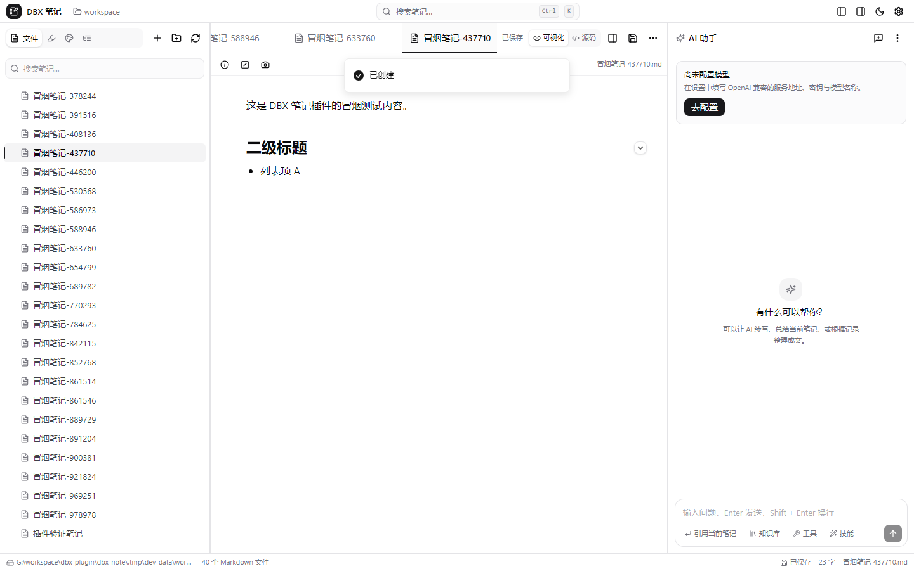
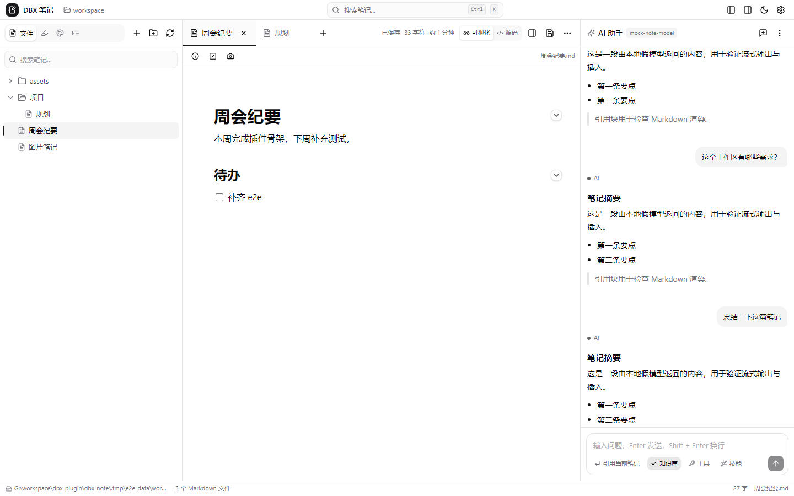

# DBX 笔记（dbx-note）

本地优先的 Markdown 笔记与碎片记录工作台，作为 **DBX 插件**运行。
工作区就是你自己的文件夹，笔记是普通 `.md` 文件；记录、标签、AI 会话存在插件自带的 SQLite 里。
界面与交互参考开源项目 [NoteGen](https://github.com/codexu/note-gen) v0.39.2 的产品形态，按 DBX 插件体系重新实现。



## 1. 功能

### 已实现

| 模块 | 能力 |
| --- | --- |
| 工作台布局 | 顶部工具栏 + 左（文件 / 记录 / 画布 / 大纲）+ 中（编辑器 + 编辑器底栏）+ 右（AI 助手）+ 底部状态栏，各栏可拖拽、可折叠；窄屏自动切单栏 |
| 文件 | 工作区目录选择（自绘目录树，支持磁盘 / 快捷位置 / 新建文件夹）、文件树展开收起、新建笔记与文件夹、重命名、删除二次确认、外部改动刷新 |
| 文件树操作 | 与参考项目一致的两组入口：工具栏「更多」菜单含**文件视图**（按名称 / 修改时间 / 大小排序与升降序、全部折叠、显示资源文件夹、显示知识库状态）、**远程文件**（显示远程文件、上传静态资源、上传本地文件、下载远程文件）、**知识库**（自动更新、全部重新计算、上传 / 下载）、**导入**（导入笔记、导入为 Markdown、导入 Notion `.zip`）；节点右键菜单含新建 / 展开折叠 / 查看目录 / 从模板新建笔记 / 知识库 / 剪切 `Ctrl+X` / 复制 `Ctrl+C` / 创建副本 / 粘贴 `Ctrl+V` / 上传下载文件夹 / 重命名 `F2` / 删除 `Del`。排序与显示开关写入设置并持久化；快捷键只在焦点落在文件树时生效，不抢编辑器输入；「知识库」等价映射为工作区 `.dbx-note/kb-index.json` 索引快照，随云同步带走 |
| 标签页 | 多文件同时打开：标签栏横向滚动、激活态底部高亮条、未保存脏标、中键或 `×` 关闭、右键关闭自身 / 其他 / 左侧 / 右侧 / 全部；`+` 新建笔记或切换记录；退出后恢复上次标签（存 Sidecar） |
| 编辑器 | Tiptap 可视化编辑与 CodeMirror 源码模式切换；标题（1–6 级）、列表、任务列表、引用、链接、下划线、对齐；选中文本浮出格式工具条（含**字体颜色 / 高亮颜色** 六色板与「清除格式」），颜色以 `span[data-dbx-color]` / `mark[data-dbx-color]` 写回 Markdown；800ms 防抖自动保存、切换标签前强制落盘；粘贴剪贴板图片自动落到 `assets/`；**`Ctrl/⌘ + F` 搜索替换**（全部命中高亮 + 当前命中加深、`n/m` 计数、上一个 / 下一个、区分大小写、替换 / 全部替换）；**GitHub Alert 提示块**（`> [!NOTE]` / `TIP` / `IMPORTANT` / `WARNING` / `CAUTION`，左侧彩条 + 图标 + 类型下拉，Markdown 原样往返）；表格 / 公式 / 图表 / 折叠等快捷键见文档 8.40 |
| 选区 AI | 选中文字后气泡工具条最左侧的星标按钮：**润色 / 精简 / 扩展**、**从选区生成画布**（流程图 / 思维导图 / 时间线 / 任务关系）、**翻译**（英日韩法德西葡俄 8 种 + 自定义语言）。文本类动作走流式接口，结果先在面板里预览，点「替换选区 / 插入到下方」才写回正文，随时可取消；生成画布不依赖模型，按行 / 日期 / 待办规则排版后直接落盘打开 |
| 块手柄 | 鼠标悬停段落左侧浮出 `⠿` + `+`：复制内容、复制 Markdown、创建副本、上移、下移、转换为（正文 / H1–H6 / 无序 / 有序 / 任务列表，共 10 种）、清除格式、删除、在下方插入块 |
| 公式 | 行内 `$…$` 与块级 `$$…$$` 都是真实节点，KaTeX 以 MathML 输出渲染（不依赖外部字体，沙箱里不会因 CSP 变形），点击可编辑源码；**行内与块级编辑态都带八个常用示例**（分数 / 上标 / 下标 / 平方根 / 求和 / 积分 / 极限 / 希腊字母，共用同一份清单），点一下把 LaTeX 插到光标处；块级公式另可经斜杠命令弹窗插入：Σ 标题 + LaTeX 输入 + KaTeX 实时预览 + 示例一键填入 |
| 图表 | Mermaid 8 种图（流程图 / 时序图 / 甘特图 / 类图 / 状态图 / 饼图 / ER 图 / 旅程图）为独立节点：实时渲染 SVG、点击改源码、可切图类型，存回仍是 ```` ```mermaid ```` 围栏；主题跟随界面深浅色 |
| 代码块 | CodeBlockLowlight 语法高亮 + 右上角工具条：34 种语言下拉（写回 ```` ```lang ````）与一键复制 |
| 表格 | 光标进入表格时上方浮出圆角工具条（`createPortal` 到 body + `fixed` 定位，不会被单元格裁切）：**行**上插 / 下插 / 删行（红）、**列**左插 / 右插 / 删列（红）、**对齐**左·中·右（按当前单元格 `align` 高亮）、**删表**（红色垃圾桶），四组之间竖线分隔；不可用的动作自动置灰，悬停提示统一朝上带小箭头 |
| 标题折叠 | 标题行右端**常显**胶囊按钮（不靠 hover 才发现）：展开态淡边框 ▾、折叠态换主题色 ▸，一键收起该标题到下一个同级或更高级标题之间的内容，折叠处显示「已折叠 N 个内容块」提示条，点击可再展开；带 `aria-expanded`，键盘与读屏可用 |
| 斜杠命令 | 空行行首输入 `/`（或点块手柄 `+`、顶部「插入块」、`Ctrl/⌘ + /`）弹出命令面板：左栏**一屏列全** 6 组分类（AI 4 / 标题 6 / 列表 3 / 块级 8 / 数学 2 / 图表 8，共 31 条，带计数），右栏命令列表；`↑↓` 选项、`←→` 切分类、`Enter` 执行、`Esc` 取消；继续输入即搜索。AI 类命令走流式接口，结果插入光标处；「提示块」插入 GitHub Alert；「文件」命令打开工作区文件面板，插入相对路径链接 |
| 编辑器头部 | 顶部第二行：笔记信息（文件名 / 目录 / 字数 / 行数 / 标题数）与「插入块」（自动起一行输入 `/`），右侧显示当前文件路径 |
| 编辑器底栏 | 编辑区最下方独立一栏：**复制**（Markdown / HTML / JSON / 纯文本 4 种格式写入系统剪贴板）、**导出**（Markdown / HTML / JSON / PDF）、**大纲**（复用左侧栏页签，收起时自动展开）、**字符数**（不含空白），右侧 **历史版本**。内容源统一取当前笔记的 Markdown，可视化 / 源码模式拿到的都是最新正文；顶部标签栏已有模式切换，底栏不重复放入口 |
| 导出落盘 | 与参考项目一致：**弹系统「另存为」对话框并置顶**（绑定宿主窗口为 owner + `HWND_TOPMOST` hook），由 Sidecar 在用户选定的路径写盘，并把实际路径回显在提示里；取消不写盘也不报成功。四种格式各自规范化扩展名，不会沿用上一次的 `.html` 过滤器。JSON 导出的是 Tiptap JSON 文档，HTML 导出会把工作区图片内联成 data URL（导出文件离开工作区也不丢图），PDF 走**顶层独立打印窗口**「另存为 PDF」（避开 iframe 沙箱），打印被禁时降级为 `*.print.html` 并明确提示，不伪装成普通 HTML 导出。macOS / Linux 没有原生对话框时降级为浏览器下载并明确提示保存位置 |
| 历史版本 | 与参考项目一致：数据源是**远端 Git 仓库对当前笔记的提交历史**（最近 10 条），每条显示短 sha（点开远端 commit 页）、提交说明、作者、时间，面板顶部有「在仓库中打开」链接；按完整 sha 取该版本正文恢复。仅当配置 GitHub / Gitee / GitLab / Gitea 且工作区是独立 Git 仓库并设置了 `origin` 时显示入口，其它同步方式下入口隐藏。恢复是高危写操作，增加二次确认；正在编辑的内容会先落盘，避免被防抖保存覆盖 |
| 分屏对照 | 编辑区右上按钮或 `Ctrl/⌘` + 反斜杠开合右侧对照面板，独立读写另一篇笔记，适合边写边对照 |
| 画布 | 侧栏「画布」页签：左上竖排工具条八个入口（选择 `V` / 平移 `H` / 铅笔 `P` / 荧光笔 `M` / 橡皮 `E` / 图形库 / 数据图表 / 图片，`Esc` 回选择）；图层支持卡片（双击空白新建）、17 种图形（常用 4 + 流程图 10 + 数据与存储 3，可拖入落点）、6 种数据图表（柱 / 折线 / 面积 / 饼 / 雷达 / 径向，数据面板可粘贴表格）、图片节点与手绘笔迹，图形/图表/图片可拖右下角缩放；圆点连线、平移缩放（以光标为锚点）、整理布局、适应画布内容、重置视图；小地图显示内容概览与当前视口框，点一下即跳转；文档存 `canvases/*.canvas.json`，防抖自动保存 |
| 图片 | 文件树显示图片节点，点开为预览弹窗（Sidecar 读成 data URL 内联）；目录与命名规则可配置（UUID / 时间戳 / 原名）；弹窗内可「识别文字」（多模态模型）并复制或插入笔记；宿主禁止加载图片时降级为说明 + 复制路径 |
| 语音 | `Ctrl/⌘ + M` 或记录面板麦克风按钮：录音由 Sidecar 直接用系统麦克风采集（cpal，不经过宿主 iframe 的权限），带计时、可随时停止，结束后自动转写；也可选择 / 拖入音频文件。转写结果可编辑后插入笔记 |
| 截图 | **在真实桌面上 1:1 框选**：按全局热键（默认 `Alt+Shift+Z`，被占用时自动退到 `Ctrl+Alt+Z` → `Alt+Shift+X` → …，实际生效的组合显示在设置 → 快捷键）或点编辑器头部相机按钮，Sidecar 会建一个覆盖全部显示器的置顶窗口，把抓到的画面按原尺寸画上去（选区外压暗、左上角实时尺寸，拖拽时只重绘变化的选区带，画面实时跟手），鼠标直接拉框；**全局截图在复制 / 保存前，可用选区框上的 8 个定位点（悬停显示系统双箭头）拖拽调整选区大小**，标注、工具栏与最终输出尺寸同步跟着走；松手后把区域交回插件浮层做标注（选择 `V` / 矩形 `R` / 椭圆 `O` / 箭头 `A` / 画笔 `P` / 文字 `T` / 马赛克 `M`，8 色 + 4 档笔宽，`Ctrl+Z` 撤销重做）→ **复制到系统剪贴板 / 钉在顶层 / 下载 / 插入笔记 / 保存到记录**。全局按下时选完会把**宿主窗口激活到前台并接回可标注的浮层**（工具栏 + 复制 / 插入 / 记录），同时进系统剪贴板，并在工作区右下角弹一个**不抢焦点**的结果预览窗（缩略图 + 「已复制到剪贴板 · 回到 DBX 可继续标注（W × H）」，6 秒自动消失），同时留一份挂起项，回到插件窗口即可继续标注；导出按原图分辨率还原（2x DPI 也不糊）。标注浮层的工具条**常驻在图片正下方**（普通流布局，不依赖视口测量），画面缩放交给解码器按画布后备像素高质量重采样后 1:1 贴图，窄面板下密集小字也不会被采成条纹 |
| 大纲 | 解析当前笔记标题层级，点击联动编辑器滚动定位 |
| 记录 | 文本 / 链接 / 待办三种快速记录（另收截图工具送来的**图片**记录，带缩略图）；搜索 + 类型多选 + 时间（全部 / 今天 / 近 7 天 / 近 30 天）+ 标签过滤；待办可直接勾选完成（`meta.done`，完成态删除线）；回收站可恢复或彻底删除；勾选多条后交给 AI 整理成新笔记 |
| AI 模型配置 | **多厂商 + 多模型**：每家厂商一张卡片（预置 OpenAI / Gemini / DeepSeek / 通义千问 / 智谱 / Moonshot / SiliconFlow / OpenRouter / Groq / Together / xAI / Ollama / LM Studio，也可自定义），填服务地址与密钥后可「测试连接」拉取模型列表、点选加入；每个模型单独设用途（对话 / 图片识别 / 语音转写 / 向量 / 语音合成）、温度、topP、maxTokens、流式开关；「对话与写作 / 图片识别 / 语音转写」三处默认模型分别指向具体模型，同一插件里由不同模型分担不同任务。旧版单模型配置在打开设置时自动迁移为「一家厂商 + 一个对话模型」 |
| AI 助手 | 多会话（历史 / 重命名 / 删除）、流式输出、引用当前笔记、结果复制与插入笔记、输入框上方可切换对话模型；知识库检索、长期记忆、技能库、本机 MCP 工具 |
| 工具（MCP） | 设置 → 工具：添加本机 MCP 服务（命令 + 参数）、检测工具清单、填 JSON 参数试运行；对话里可让助手按需调用 |
| 搜索 | 文件名 + 正文全文搜索，摘要高亮，键盘上下选择、回车打开 |
| 云同步（Git） | 设置 → 同步：把工作区当 Git 仓库，初始化 / 提交 / 拉取 / 推送；可选 GitHub / GitLab / Gitee / Gitea 与访问令牌（只在推送时使用，不写入 `.git/config`），支持自动提交与提交信息模板。**进入应用 / 回到前台时自动拉远端目录清单**，仅云端笔记会显示在文件树里（云下载图标），点开才下载正文，不预先拉全文；**打开笔记时逐文件比对远端并自动拉取**：本地未改、远端改过 → 直接更新；两边都改 → 弹窗选保留哪边；另有「拉取全部远程文件」用于新设备首次同步。「自动同步间隔」设为关闭只关自动推送，不影响打开时拉取。推送时若远端已领先会自动合并一次再推 |
| 云同步（文件镜像） | 同一页可切到对象存储（S3 兼容：AWS / R2 / OSS / COS / MinIO / B2 / 自定义）、WebDAV（逐级 MKCOL + Basic）、自托管（GET/PUT/DELETE + Bearer）；按 `manifest.json` 里的 `大小:SHA-1` 做增量上传下载，本地状态记录在 `.dbx-note/sync-state.json`，重复执行幂等、冲突保留本地；同步选项含「自动同步笔记」延迟（关闭 / 2 秒 … 2 分钟）、「打开或切换文件时自动拉取」、应用数据同步四个开关与冲突处理策略 |
| 备份与恢复 | 一键把工作区打包成 zip 存到数据目录，列出历史备份，可恢复到新目录或覆盖当前工作区，也可删除 |
| 设置 | 外观（浅色 / 深色 / 跟随系统）、界面语言（简中 / 英 / 日 / 韩 / 泰）、字号、正文宽度、AI 模型（厂商与模型、默认模型按用途分配）、助手（知识库 / 记忆 / 技能）、工具（MCP）、图片与语音（目录、命名、识别与转写模型、截图说明）、同步与备份、工作区切换与恢复默认、版本与数据目录（含 **Sidecar 日志**：查看最近 300 行 / 复制 / 打开日志目录） |
| i18n | 词条集中在 `src/lib/i18n.ts`，未翻译条目自动回退英文 |



### 尚未实现（后续版本）

- 全局截图热键的候选链由 Sidecar 决定：`Alt+Shift+Z` 被宿主或别的软件占用时会自动换下一个，用户不能自定义全局组合（插件内的绑定可以改）
- 向量检索：沙箱内无 embedding 服务，知识库改为「全文检索 + 截断注入」
- 上下分屏、画布协作 / 撤销栈、同步冲突自动合并、增量备份

## 2. 目录结构

```
dbx-note/
├─ manifest.json               插件清单（id / 权限 / 入口 / 贡献点 / 本地化）
├─ dbx-plugin.toml              打包配置（Rust Sidecar + 需要随包的文件）
├─ index.html                   Vite 入口
├─ src/
│  ├─ main.tsx                  挂载入口
│  ├─ App.tsx                   外壳、初始化、快捷键、弹窗挂载
│  ├─ style.css                 设计令牌 + 编辑器 / Markdown 样式
│  ├─ lib/
│  │  ├─ bridge.ts              宿主桥接（ready / locale / theme / copy / invoke）
│  │  ├─ rpc.ts                 Sidecar 方法封装与类型
│  │  ├─ i18n.ts                五语言词条
│  │  ├─ markdown.ts            AI 消息 Markdown 渲染 + 消毒
│  │  ├─ editorBus.ts           编辑器与外部组件的操作通道
│  │  └─ utils.ts / constants.ts / useT.ts
│  │  ├─ tree.ts                文件树拍平 / 远端清单合并 / 文件视图偏好
│  │  ├─ fileActions.ts         文件树菜单动作（选文件 / 解包 / 导入 / 剪贴板 / 知识库）
│  │  ├─ markdownExport.ts      复制与导出（另存为 / 图片内联 / 顶层打印）
│  │  ├─ autoSync.ts            打开时拉取 / 自动推送 / 按需下载
│  │  ├─ split.ts               对照面板开合规则（按钮与快捷键共用）
│  │  ├─ slashCommands.ts       斜杠命令清单与执行（结构命令 / AI 命令）
│  │  └─ useMediaQuery.ts       窄屏判定
│  ├─ stores/                   zustand：settings / notes / records / chat / canvas / ui / kb
│  └─ components/
│     ├─ TitleBar.tsx LeftSidebar.tsx FileTree.tsx FileMoreMenu.tsx RecordPanel.tsx OutlinePanel.tsx
│     ├─ EditorTabBar.tsx EditorPane.tsx EditorMetaBar.tsx SidePane.tsx MobileNav.tsx
│     ├─ MarkdownEditor.tsx EditorToolbar.tsx SourceEditor.tsx
│     ├─ ChatPanel.tsx StatusBar.tsx
│     ├─ editor/                SlashMenu（斜杠命令浮动面板）
│     ├─ canvas/                CanvasEditor / CanvasPanel
│     ├─ dialogs/               Settings（通用 / AI / 助手 / 工具 / 图片与语音 / 同步 / 工作区 / 关于）/ Search / DirPicker / DeleteConfirm / ImageDialog / VoiceDialog
│     └─ ui/                    基础组件（按钮、输入、弹窗、菜单、提示等）
├─ backend/                     Rust Sidecar（stdio JSON-RPC）
│  ├─ src/main.rs               协议主循环与方法分发
│  ├─ src/files.rs              工作区、文件树、读写、搜索、目录浏览
│  ├─ src/fileops.rs            文件树菜单动作（复制 / 移动 / 导入 / 模板 / 知识库索引）
│  ├─ src/gitsync.rs            Git 通道按文件比对、单文件拉取、远端目录清单
│  ├─ src/githistory.rs         远端 Git 提交历史与按 sha 恢复
│  ├─ src/native.rs             Win32：剪贴板 / 热键 / 钉图 / 另存为对话框（含 *_stub.rs）
│  ├─ src/db.rs                 SQLite：记录 / 标签 / 会话 / 消息 / 设置 / 历史
│  ├─ src/ai.rs                 AI 代理（流式轮询 / 图片识别 / 语音转写）与通用 HTTP
│  ├─ src/canvas.rs             画布文档读写（canvases/*.canvas.json）
│  ├─ src/sync.rs               Git 云同步（调用本机 git）与同步配置
│  ├─ src/storesync.rs          对象存储 / WebDAV / 自托管：文件镜像 + 清单增量
│  ├─ src/backup.rs             工作区备份 / 恢复（zip）
│  ├─ src/mcp.rs                本机 MCP 服务代理（stdio JSON-RPC）
│  └─ rust-toolchain.toml       固定 GNU 工具链（无 MSVC 环境）
├─ assets/plugin.svg            插件图标
├─ scripts/                     开发宿主、自检、端到端、打包
├─ docs/                        版本部署变更说明
└─ licenses/                    第三方许可证副本
```

## 3. 开发

### 3.1 环境

- Node.js 22+
- Rust（Sidecar）：`npm run backend` 已固定 `stable-x86_64-pc-windows-gnu`；Windows 上若没有 MSVC Build Tools，需装 MinGW-w64（gcc）

### 3.2 平台支持

同一个插件按平台各打一个包（带原生 Sidecar 的插件出不了 universal 包，只能靠 CI 矩阵）：

| 平台 | 包名 | 笔记 / 编辑器 / AI / 同步 | 截图 · 贴图 | 剪贴板位图 | 麦克风录音 | 系统 OCR |
| --- | --- | --- | --- | --- | --- | --- |
| Windows x64 | `…-windows-x64.dbxp` | 完整 | 可用 | 可用 | 可用 | 可用（WinRT） |
| macOS arm64 | `…-darwin-arm64.dbxp` | 完整 | 不可用 | 不可用 | 不可用 | 不可用（可退回视觉模型识别） |
| macOS x64 | `…-darwin-x64.dbxp` | 完整 | 同上 | 同上 | 同上 | 同上 |
| Linux x64 | `…-linux-x64.dbxp` | 完整 | 同上 | 同上 | 同上 | 同上 |
| Linux arm64 | `…-linux-arm64.dbxp` | 完整 | 同上 | 同上 | 同上 | 同上 |

非 Windows 平台之所以是「不可用」而不是「编译不过」：截图 / 剪贴板位图 / 录音 / 系统 OCR
这四个模块直接调 Win32（GDI、CF_DIB、COM、WinRT），已用 `#[cfg(windows)]` 收敛到
`backend/src/{native,ocr,screenshot,pin,screenshot_ink}.rs`，其他平台编同名同签名的
`*_stub.rs`，协议层照常分发、调用时返回「当前平台暂不支持该能力」。

### 3.3 常用命令

```bash
npm install

# 构建前端（单文件产物输出到 ui/）
npm run build

# 构建 Sidecar（产物 backend/target/release/backend.exe）
npm run backend

# 启动本地开发宿主：静态服务 + 真实 Sidecar + 模拟 window.dbxPlugin
npm run devhost            # http://127.0.0.1:5195
# 自动化（e2e / smoke）要加环境变量：截图跳过桌面框选窗口；热键只注册冷门组合（e2e 走全局热键全链路）/ 不注册（smoke）
# e2e 还需 DBX_NOTE_EXPORT_AUTO_DIR 跳过系统另存为模态框、DBX_NOTE_HISTORY_OFFLINE=1 跳过联网 fetch
DBX_NOTE_SCREENSHOT_MODE=plugin DBX_NOTE_SHOT_HOTKEY=Ctrl+Alt+F9 DBX_NOTE_SCREENSHOT_AUTO=40,40,600,300,900 \
  DBX_NOTE_EXPORT_AUTO_DIR="$PWD/.tmp/e2e-exports" DBX_NOTE_HISTORY_OFFLINE=1 \
  node scripts/devhost.mjs --port 5196 --data .tmp/e2e-data
# 自检可用 DBX_NOTE_CHECK_DATA 指定全新数据目录，避免清理旧目录被宿主的批量删除保护拦截
DBX_NOTE_CHECK_DATA=.tmp/check-fresh npm run sidecar-check

# 假模型服务（OpenAI 兼容，用于验证流式对话）
npm run mock-ai            # http://127.0.0.1:5199/v1

# 测试
npm run sidecar-check      # 后端协议 205 项断言（含截屏 / 桌面框选 / 像素自检 / 钉在顶层 / 系统 OCR / 剪贴板读写 / 全局热键 / 录音 / 画布 / 图片 / 识别 / 转写 / MCP / 同步通道 / 远端清单 / 另存为导出 / 远端提交历史 / 备份）
npm run smoke              # 界面冒烟 25 项 + 截图（含大纲 H1~H6 全级别点击定位）
node scripts/mock-mcp.mjs  # 假的 MCP 服务（e2e 与自检用，暴露 echo / now）
npm run e2e                # 端到端约 330 项（标签页 / 搜索 / AI 多厂商配置 / 选区 AI / 画布图形库与图表 / 手绘 / 截图工具与全局热键 / 图片设置面板 / 编辑器底栏 / 历史版本 / 对照 / 斜杠命令 / 标题折叠 / 公式往返 / 同步 / 备份 / 识别 / 语音 / MCP / 窄屏）

# 打包
npm run pack:local         # 直接使用已构建的 Sidecar 生成 .dbxp
npm run pack               # 官方 CLI 打包（会强制用 msvc 重新编译 Sidecar，需要 MSVC）
```

`npm run devhost -- --port 5196 --data .tmp/e2e-data --workspace <目录>` 可指定端口、数据目录与工作区。

### 3.4 在 DBX 里调试

```bash
npm run build
npx dbx-plugin dev --path . --port 5190
```

说明：CLI 的 `dev` 会用 **msvc** 工具链重新编译 Rust Sidecar，本机若无 MSVC 会失败（见 6.2）。
此时用 `npm run devhost` 联调，行为与宿主一致（同样的桥接对象、同样的 Sidecar 协议）。

## 4. 架构

### 4.1 为什么需要 Sidecar

插件页面被宿主注入到 `sandbox="allow-scripts"` 的 iframe，CSP 为
`default-src 'none'; script-src 'unsafe-inline' blob:`：

- 没有 `localStorage` / `IndexedDB`（origin 为 `null`，访问即抛 SecurityError）
- 页面 `fetch` 发不出去（`connect-src 'none'`）
- 系统文件选择框被拒绝（`showDirectoryPicker` 报 SecurityError）

因此文件读写、SQLite 存储、AI 请求全部交给原生 Sidecar，前端只通过
`window.dbxPlugin.invoke(method, params, { timeoutMs })` 走 JSON-RPC。

### 4.2 通信

```
插件 UI  ──invoke──▶  DBX 宿主  ──stdin/stdout JSONL──▶  Rust Sidecar
                                                     ├─ 工作区文件
                                                     ├─ SQLite
                                                     └─ 模型 HTTP（含 SSE）
```

- 协议：DBX Plugin Protocol v1；握手返回 `protocolVersion / capabilities / plugin`
- `Metadata.version` 必须等于 `manifest.json` 的 `version`，否则宿主报
  `Sidecar identity or protocol does not match manifest`
- 流式对话：`ai/start` 立即返回 id，Sidecar 后台线程累积增量，前端每 140ms `ai/poll` 读取

### 4.3 Sidecar 方法

| 分类 | 方法 |
| --- | --- |
| 握手 | `plugin/initialize`、`ping` |
| 工作区 | `workspace/describe`、`workspace/set`、`workspace/reset` |
| 目录 | `fs/listDirs`、`fs/mkdir`（沙箱内自绘目录选择器） |
| 文件 | `fs/tree`、`fs/read`、`fs/write`、`fs/create`、`fs/rename`、`fs/delete`、`fs/stat`、`fs/search` |
| 图片 | `image/save`（base64 → `assets/`，可选目录与命名规则）、`image/read`（→ data URL）、`ai/vision`（多模态识别） |
| 画布 | `canvas/list`、`canvas/read`、`canvas/create`、`canvas/save`、`canvas/rename`、`canvas/delete` |
| 系统能力 | `screen/capture`（GDI 抓主屏 → PNG base64）、`screenshot/select`（桌面 1:1 全屏框选，返回裁剪区域）、`screenshot/takePending`、`screenshot/hotkey`、`clipboard/image`（CF_DIB → PNG base64）、`clipboard/write`（PNG → CF_DIB 进系统剪贴板）、`audio/recordStart`、`audio/recordStop`（→ WAV base64）、`audio/recordStatus` |
| 同步（Git） | `sync/status`、`sync/options`、`sync/saveOptions`、`sync/init`、`sync/remote`、`sync/commit`、`sync/pull`、`sync/push` |
| 同步（文件镜像） | `sync/storeOptions`、`sync/saveStoreOptions`、`sync/storeCheck`、`sync/storeStatus`、`sync/storePush`、`sync/storePull` |
| 备份 | `backup/export`、`backup/list`、`backup/import`、`backup/delete`、`backup/info` |
| 工具 | `mcp/list`、`mcp/save`、`mcp/tools`、`mcp/call` |
| 记录 | `record/list`、`record/create`、`record/update`、`record/delete`、`tag/list`、`tag/create`、`tag/delete` |
| 会话 | `chat/list`、`chat/create`、`chat/rename`、`chat/delete`、`chat/messages`、`chat/append` |
| 设置 | `settings/get`、`settings/set`、`history/list` |
| AI | `ai/chat`、`ai/start`、`ai/poll`、`ai/cancel`、`ai/models`、`ai/transcribe`、`net/request` |

### 4.4 存储布局

```
<DBX_PLUGIN_DATA_DIR>/
├─ config.json        工作区根目录
├─ dbx-note.db        SQLite（记录 / 标签 / 会话 / 消息 / 设置 / 文件历史）
├─ backups/           工作区备份（*.zip，设置 → 同步 → 备份与恢复）
├─ restore-<时间戳>/   恢复目标目录（默认解到这里，可手动删除）
└─ workspace/         默认工作区，可在设置里换成任意目录
   ├─ 笔记.md
   ├─ 项目/
   ├─ canvases/       画布文档（*.canvas.json）
   └─ assets/         图片附件（粘贴图片自动落这里，目录可在设置里改）
```

SQLite 表：`settings`、`records`、`tags`、`record_tags`、`chats`、`messages`、`file_history`。
其中 `settings` 里除外观 / 语言 / AI 配置外，还存 `app.tabs`（上次打开的标签与激活项）、
`app.mcp`（本机 MCP 服务配置）、`app.sync`（托管平台 / 令牌 / 自动提交 / 提交信息模板）；
宿主沙箱没有 localStorage，所以这些都走后端。

## 5. 使用

1. 打开插件，默认工作区是插件数据目录下的 `workspace/`。
2. 点顶部工作区名或设置 → 工作区，选择任意已有 Markdown 目录（例如你的笔记库）。
3. 左侧「文件」新建笔记，直接可视化编辑；需要改语法时切到「源码」。
   再打开别的笔记会追加为标签页，切换标签不会丢改动。
4. 左侧「记录」随手记想法，打标签；需要成文时勾选记录 → 「整理成笔记」。
5. 右侧「AI 助手」先在设置 →「AI 模型」里 **添加厂商**（服务地址 + 密钥），点「测试连接」拉取模型列表，
   点选要用的模型加入；再把下方「对话与写作」默认模型指向它即可对话、总结、续写。
   同一个页面还能给「图片识别」「语音转写」各指定一个模型，由不同模型分担不同任务。
   打开「引用当前笔记」会把当前笔记作为上下文，回答可一键插入笔记；
   「知识库」会先在工作区做全文检索再提问，「工具」允许助手调用设置里配置的 MCP 服务。
6. 左侧「画布」梳理流程：双击空白建卡片、拖右侧圆点连线、工具条取图形 / 图表 / 图片，
   铅笔与荧光笔可直接手绘，滚轮缩放、右下角拉大小。
7. 正文空行输入 `/`（或点顶部「插入块」）唤出命令面板，插入标题 / 列表 / 代码块 / 图表，或让 AI 续写、总结。
8. 设置 → 图片与语音：配置图片落盘目录与命名规则、图片识别与语音转写模型；
   截图按 `Alt + Shift + Z` 或点编辑器头部相机按钮，由本机服务直接抓屏后进入框选与标注。
9. 设置 → 同步 里填远端地址，即可把整个工作区当 Git 仓库备份到 GitHub / Gitee / 自建 Git；
   也可以把平台切到对象存储 / WebDAV / 自托管，按文件镜像做增量同步（不需要装 git）；
   下方「备份与恢复」可随时把工作区打包 / 还原。

### 5.1 快捷键

| 快捷键 | 作用 |
| --- | --- |
| `Ctrl/⌘ + S` | 立即保存当前笔记 |
| `Ctrl/⌘ + N` | 新建笔记（落在当前文件同级目录） |
| `Ctrl/⌘ + F` | **正在编辑笔记时**打开笔记内搜索替换（`n/m` 计数、上一个 / 下一个、区分大小写、替换 / 全部替换）；焦点不在编辑器时仍是全局搜索 |
| `Ctrl/⌘ + K` | 全局搜索（文件名 + 正文） |
| `Ctrl/⌘ + W` | 关闭当前标签（`Shift` 加成：关闭全部） |
| `Ctrl/⌘ + Alt + ← / →` | 在已打开的标签间切换 |
| `Ctrl/⌘ + B` / `Ctrl/⌘ + J` | 显隐左侧栏 / 右侧 AI 面板 |
| `Ctrl/⌘` + 反斜杠 | 开合右侧对照面板 |
| `Ctrl/⌘ + M` | 语音转写（录音或选择音频文件） |
| `Alt + Shift + Z` | 截图：桌面上 1:1 框选区域 → 标注 → 复制 / 钉在顶层 / 下载 / 插入笔记 / 保存到记录（插件内的绑定；系统级全局热键由 Sidecar 另行注册，实际组合见设置 → 快捷键） |
| `Ctrl/⌘ + Shift + A` | 截图工具（旧默认值，已迁移为 `Alt + Shift + Z`，可在设置里改回） |
| `Ctrl/⌘ + Shift + F` | 全局搜索 |
| `Ctrl/⌘ + Shift + S` | 打开同步设置 |
| `Ctrl/⌘ + ,` | 打开设置 |
| `/` | 在空行行首唤起斜杠命令面板（`↑↓` 选项、`←→` 切分类、`Enter` 执行、`Esc` 取消）；`Ctrl/⌘ + /` 在任意位置唤起 |
| `Ctrl/⌘ + Alt + T` | 插入 3×3 表格 |
| `Shift + Ctrl/⌘ + Alt + L / R` | 表格内左 / 右插入列 |
| `Shift + Ctrl/⌘ + Alt + U / D` | 表格内上 / 下插入行 |
| `Ctrl/⌘ + Alt + Backspace` / `Shift + Ctrl/⌘ + Alt + Backspace` | 删除当前列 / 当前行 |
| `Ctrl/⌘ + Alt + Delete` | 删除表格 |
| `Shift + Ctrl/⌘ + L / E / R` | 单元格左 / 中 / 右对齐 |
| `Ctrl/⌘ + Alt + M` / `Shift + Ctrl/⌘ + Alt + M` | 插入行内公式 / 打开块级公式弹窗 |
| `Ctrl/⌘ + Alt + D` | 插入流程图（Mermaid） |
| `Ctrl/⌘ + Alt + ↑ / ↓` | 全部折叠 / 全部展开标题 |
| `V H P M E` | 画布工具：选择 / 平移 / 铅笔 / 荧光笔 / 橡皮（`Esc` 回选择）；图形库、数据图表、图片走工具条按钮 |

标签右键菜单还提供「关闭其他 / 关闭左侧 / 关闭右侧 / 关闭全部」，中键点击标签可直接关闭。

## 6. 已知限制

### 6.1 宿主沙箱

- **图片可能不渲染**：CSP 若把 `img-src` 也归到 `'none'`，图片与预览无法显示。
  预览弹窗对 `data:` 内联做了 `onError` 降级（说明 + 复制路径），不会白屏。
- **无法使用浏览器存储**：设置、记录等全部走后端，前端只在内存中缓存。
- **无法弹出系统对话框**：新建 / 重命名 / 删除全部用插件内自绘的输入框与确认框。
- **系统能力走 Sidecar**：宿主 iframe 没有屏幕捕获与麦克风权限（`getUserMedia` 会一直挂着），
  所以截屏（GDI BitBlt）、剪贴板位图（CF_DIB）、录音（cpal）都在 Sidecar 里做，
  UI 只通过 `screen/capture`、`clipboard/image`、`audio/recordStart|Stop` 调用。
  仍需系统层面授权：Windows 要在「隐私和安全性 → 麦克风」里允许桌面应用访问麦克风，
  录屏在锁屏 / 无交互会话下会被系统拒绝（此时截图会退到剪贴板）。

### 6.2 构建

- 未安装 MSVC Build Tools 时，官方 `dbx-plugin dev` / `dbx-plugin package` 无法编译 Rust
  （CLI 固定 msvc target，且 Git 自带的 `link.exe` 会抢占链接器）。
  已通过 `npm run pack:local` 绕过；安装了 MSVC 的环境可直接用官方 CLI。
- 注意 `backend/rust-toolchain.toml` 只在「当前目录位于 `backend/` 内」时生效（工具链按工作目录解析）：
  在仓库根目录直接跑 `cargo build --manifest-path backend/Cargo.toml` 仍会选中 msvc 并链接失败，
  请用 `npm run backend`（脚本里显式带 `+stable-x86_64-pc-windows-gnu`）或先 `cd backend`。

### 6.3 产品范围

- 支持左右分屏对照，但不支持上下分屏；
- 知识库是全文检索 + 截断注入，没有向量检索；
- 备份为全量 zip，没有增量与定时任务；恢复不做三方合并；
- MCP 只做 stdio 传输，工具调用依赖模型按约定输出 ```` ```tool ```` 代码块（不走 function calling）。

## 7. 测试与产物

| 项目 | 结果 |
| --- | --- |
| `npm run typecheck` | 0 错误 |
| `npm run sidecar-check` | **214 / 0**；v0.5.9 新增 9 条知识图谱协议断言（结构 / 水印 / 缓存 / 块粒度 / 发现 / 阈值）全通过 |
| `npm run smoke` | **34 / 0**，截图 5 张；其中 13 条为大纲回归、9 条为 v0.5.9 知识图谱界面断言（含编辑器 hidden 保活与切回后正文仍在） |
| `npm run e2e` | **351 通过 / 1 失败**；唯一失败为「全局热键当场弹出标注工具栏」，属本机锁屏 / 远程会话无法注入全局热键的既有环境项。v0.5.9 新增 11 条图谱断言（工作区 / 控制器 / 详情区 / hidden 保活 / 参数控件 / 选中联动 / 发现关联 / 打开原笔记回到编辑器）全通过 |
| `node scripts/ui-probe-840.mjs` | 31 通过 / 0 失败（本版未重跑，历史结果） |
| 后端单元测试 | `cargo test --bin backend` **27 / 0**（v0.5.9 新增 3 条图谱单测，另含 1 条真实 Git 仓库集成用例）；`cargo check` 通过（1 条既存 `dead_code` 警告） |
| 本地产物说明 | v0.5.9 已在 `backend/` 目录内 `cargo build --release` 重建 release Sidecar（4m44s，4,471,296 B）并重新构建前端，生成可安装的 `.dbxp`；从**包内解出的** Sidecar 用 `DBX_NOTE_BACKEND` 跑 `sidecar-check` 得 **214 / 0**、握手版本 `0.5.9`；CI 的 5 平台矩阵仍只负责正式发布产物 |
| 产物 | 本地安装包 `release/com.mjj3610.note-0.5.8-windows-x64.dbxp`（3,911,385 B，sha256 `7f2fe5922127d93162a1291d2063e9e167c438e0154c68fbb2e91994f124f716`）已包含大纲修复并重新校验（12/12 checksums、Sidecar 字节一致）。**v0.5.8 已发布**：Release https://github.com/mjj3610/dbx-note/releases/tag/v0.5.8 ，5 平台 CI run `42956095802` **attempt 1 全绿**，商店候选 https://github.com/t8y2/dbx-store/pull/501 等待维护者 `/sign`；上游已上架 v0.5.7（PR #498 已签名合并） |
| v0.5.9（dev 分支） | 知识图谱已在 `dev` 分支完成 1~4 阶段实现与回归，版本号统一升到 `0.5.9`；本地安装包 `release/com.mjj3610.note-0.5.9-windows-x64.dbxp`（**3,946,626 B / sha256 `fbd55dffdfcfb84b44fc3c12963278b9b6459c580e4bc71d9bcf98db2bff2998`**），包校验 **14/0**、包内 Sidecar 协议自检 **214/0**。**未打 tag、未发 Release、未跑 5 平台 CI、未提商店候选 PR**；设计与发布边界见 `docs/知识图谱设计-v0.5.9.md` / `docs/release-notes-v0.5.9.md` / `docs/版本部署变更说明-v0.5.9.md` |

截图链路除了功能断言，还有一条**像素级自检**：`screenshot/window` 返回的
`pixels.inside` / `pixels.outside` 分别核对「选区内是否 1:1 原像素」「选区外是否压暗」，
两者 `mismatch` 都应为 `0`；同一个探针还报 `pins`（桌面钉了几张图）、
`annotate.tool`（默认应是 `Select`）、`annotate.actions`（应含 `Pin`）、
`annotate.textColor` / `textBackground`（文字工具是否沿用选中色）
（详见 `docs/版本部署变更说明-v0.4.0.md` 的 8.36 / 8.37 / 8.38 节）。

截图见 `screenshots/`：空工作区、编辑器、标签页、记录、设置、暗色、搜索、源码、AI 对话、英文界面、
目录选择、删除确认、画布、同步、助手设置、窄屏、对照面板、图片预览、MCP 工具、斜杠命令、图片识别、语音转写、
字体色与高亮、块手柄与块菜单、公式渲染、Mermaid 图表（浅色 / 暗色）、代码块语言选择、表格工具条、文件命令面板、
截图工具浮层、框选与标注、图片记录缩略图。

## 8. 许可

GPL-3.0-or-later。第三方组件许可见 `THIRD-PARTY-NOTICES.md` 与 `licenses/`。
